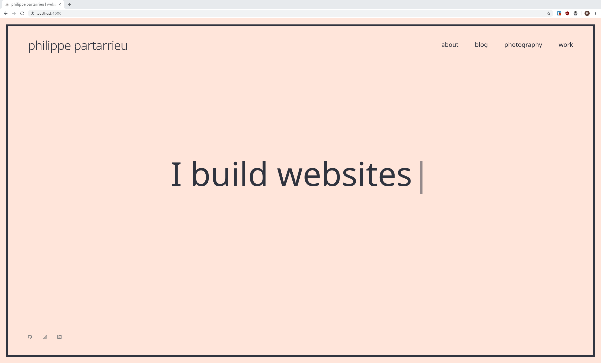

# Welcome to my website's repo



## Prerequisites

In order to run this project you will need:
* [Ruby](https://www.ruby-lang.org/en/A), preferably installed via [rvm](https://rvm.io/)
* [Jekyll](https://jekyllrb.com/) which is installed as a ruby gem


## Running the project

Use `bundle exec jekyll serve` to run the site locally.

To modify the default [minima](https://github.com/jekyll/minima) template, run `bundle show minima` then copy the file you want to modify to your directory i.e. `cp ~/.rvm/gems/ruby-2.6.4/gems/minima-2.5.1/_includes/footer.html _includes`

If you change any default values in **_layouts** you must run `bundle update`

## Font & Icon attribution
<div>Icons made by <a href="https://www.flaticon.com/authors/those-icons" title="Those Icons">Those Icons</a> from <a href="https://www.flaticon.com/" title="Flaticon">www.flaticon.com</a></div>

### Changing image colour
```bash
convert input.png -fuzz 20% -fill '#colour-out' -opaque '#colour-in' output.png
```

