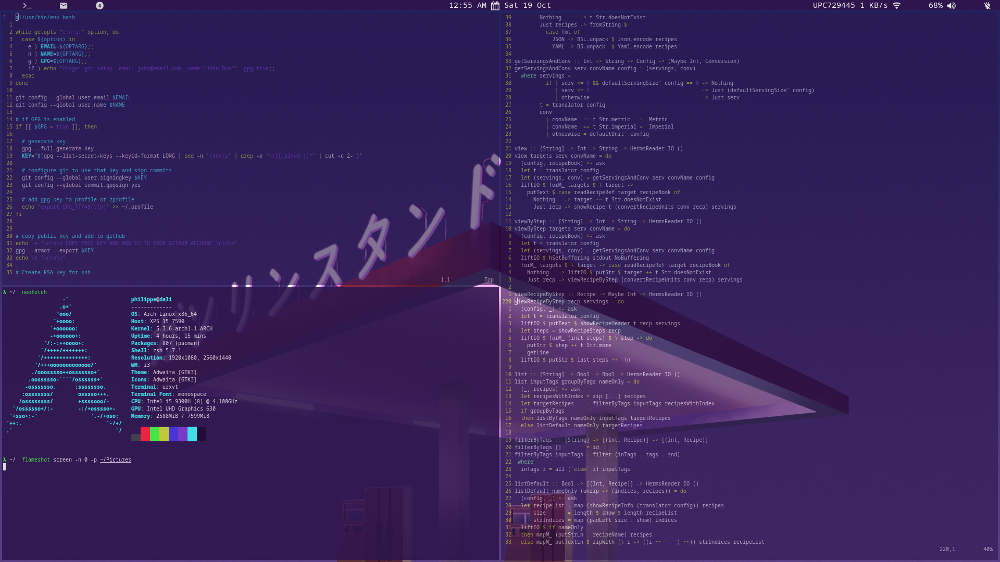

So you've spent a couple of hours installing arch and you finally have access to a shell. What more could you want? Probably a [desktop environment](https://wiki.archlinux.org/index.php/Desktop_environment) like gnome or cinnamon. If you want to try something new and exciting why not go for a [window manager](https://wiki.archlinux.org/index.php/Window_manager)? It's much more efficient in terms of system resources, and once you've ~~spent some time~~ wasted days customising your configuration files you'll have a desktop worthy of [unixporn](https://www.reddit.com/r/unixporn/). What are you waiting for? Go have a look at [i3](https://i3wm.org/) for a bit more info about and come back when you're convinced this is the right thing for you do to.

<!--more-->

If you're coming into i3 & arch for the first time, a lot of these tools are going to sound new. Once again, if you don't know what the tool is used for, don't bother installing it. You probably won't use it and it'll end up being bloatware.

So what are we going to install? Starting from the ground up, we have:
* A tilling windows manager: [i3-gaps](https://github.com/Airblader/i3)
* Terminal emulator: [rxvt-unicode](http://software.schmorp.de/pkg/rxvt-unicode.html)
* Shell: [zsh](https://www.zsh.org/)

Here's what you can expect your desktop to look like if you follow this tutorial (you can customise everything from the background picture, the transparency, the text colour scheme, to the status bar and much much more):



Okay so with that out of the way, let's start with the basics:

## User configuration
Pick a username and create a user (replace the $USERNAME with the chosen username)
```bash
# create user and add him to the wheel group
useradd -m -g users -G wheel,audio,video $USERNAME

# set your password
passwd $USERNAME

# switch to your newly created user
su $USERNAME
```

## Allow user to sudo
Like Ubuntu which has a sudo group, arch has a wheel group for admin tasks.
```bash
# comment out the following line to allow users in the wheel group to sudo
# %whell ALL=(ALL) ALL
visudo
```

### Home directories
If you `ls` in your home directory, you will realise that there are no Document, Picture, Download etc directories. I like having these since they allow me to backup my laptop and synchronise with other machines pretty easily. Let's install them!
``` bash
sudo pacman -S xdg-user-dirs
xdg-user-dirs-update
```

## Configure git
I've configured a lot of machines with git in the past so I've written a little helper script to do the work. Get the script from [here](https://gist.github.com/ppartarr/72964efb5e60a3cb11774a32ddd0e779) and run
```bash
chmod +x git.sh
# I like signing my git commits but you can set -gpg to false if you don't want to bother
./git.sh -e $EMAIL -n $FULL_NAME -g true
```

## Install an Arch User Repository (AUR) package manager
I use [yay](https://github.com/Jguer/yay) as a AUR helper and it's safe to say it's the best one out there. We're going to build it from source. I have a **src** directory in my home for all my source folders. Feel free to name this directory whatever you want.
```bash
mkdir src && cd src
git clone https://aur.archlinux.org/yay.git
cd yay
makepkg -si
```

*Note: never, I mean NEVER run `sudo yay`. By definition yay packages come from the user repository and they could be unsafe. [1]*

## i3-gaps installation
I prefer the aesthetics of [i3 gaps](https://github.com/Airblader/i3) over the regular i3. There is another fork called i3-gaps-rounded which adds rounded cornes to your windows.
If I had to argue why tiling window managers are great:
1. Keybaord driven workflow. Every aspect of your environment is configurable with keyboard shortcuts, from resizing windows to launching apps
2. Screen usage. Especially important if you have a 13 or 15 inch laptop screen. i3 allows you to switch layouts without worrying about overlapping windows
3. Performance. i3 is written in C. i3 is a window manager as opposed to desktop environment and therefore doesn't have pre-installed tools for customization (no background picture, customizable menus or desktop notifications)

```bash
# install xorg packages
sudo pacman -S xorg-server xorg-apps xorg-xinit xorg-twm

# install i3-gaps
yay -S i3-gaps

# replace i3-sensible-terminal with urxvt
vim ~/.config/i3/config

# install display manager
sudo pacman -S lightdm
yay -S lightdm-mini-greeter
```

## Some usefull tools
So here's a quick breakdown of the tools we're about to install:
* My favourite terminal multiplexer: [tmux](https://github.com/tmux/tmux/wiki)
* An open source browser: [chromium](https://www.chromium.org/)
* Mail client: [mailspring](https://getmailspring.com/)
* Tool to set my desktop wallpaper: [feh](https://wiki.archlinux.org/index.php/Feh)
* Application launcher: [rofi](https://github.com/davatorium/rofi)
* Composite manager (for windows transparency): [compton](https://github.com/yshui/compton)
* Lock screen: [i3lock-color](https://github.com/PandorasFox/i3lock-color)
* Status bar: [polybar](https://github.com/polybar/polybar)

```bash
# completely arbitrary list of stuff I use
yay -Sy vim unzip tmux htop git zsh firefox chromium vlc libsecret gnome-keyring libgnome-keyring xclip zsh feh urxvt curl compton mailspring rofi i3lock-color polybar openssh
```

### Dotfiles
You'll have noticed that we are using a lot of different tools and that all of them have configuration files. One way to keep these files synchronized is by putting them in a version control system.

Since you've made it this far and you've installed a bunch of the same tools I use, you mig want to check out my dotfiles as well. Have a look over [here](https://github.com/ppartarr/dotfiles) for more details

```bash
git clone git@github.com:ppartarr/dotfiles.git ~/.dotfiles
cd ~/.dotfiles
chmod +x symlink && ./symlink
```

### Programming languages
Here I install the stuff I usually like to code in:
* [python](https://www.python.org/)
* [haskell](https://www.haskell.org)

```bash
sudo pacman -S python python-pip
curl -sSL https://get.haskellstack.org/ | sh
```

### Oh my zsh
My favourite shell is [zsh](https://www.zsh.org/) mostly for the [ohmyzsh](https://ohmyz.sh/) framework.
```bash
# install oh-my-zsh
sh -c "$(curl -fsSL https://raw.githubusercontent.com/robbyrussell/oh-my-zsh/master/tools/install.sh)"

# install plugins
git clone https://github.com/zsh-users/zsh-autosuggestions ${ZSH_CUSTOM:-~/.oh-my-zsh/custom}/plugins/zsh-autosuggestions
git clone https://github.com/zsh-users/zsh-syntax-highlighting.git ${ZSH_CUSTOM:-~/.oh-my-zsh/custom}/plugins/zsh-syntax-highlighting

# clone my zsh theme from gist
git clone git@gist.github.com:6eeb9585dcbc3c6a8db79982ec8c21ad.git ~/.oh-my-zsh/custom/themes/haskell.zsh-theme
```

## Fonts
```bash
sudo pacman -S noto-fonts noto-fonts-emoji
```

## Audio
```bash
sudo pacman -S alsa-utils alsa-plugins alsa-lib pavucontrol
```

## Managing USB devices
As you use arch more and more you might realise that mounting USB sticks is a pain. Here's a tool that will automatically mount plugged in USB devices for you.
```bash
yay -S udisks2
```

## Volume control
```bash
sudo pacman -S xbindkeys
```

## Fluff
```bash
# To color pacman's ouput uncomment: Color
sudo vim /etc/pacman.conf
yay -S neofetch
sudo pacman -S flameshot
```

## Links & credits

[1] this reminds me of: [dont' sudo pip](https://pages.charlesreid1.com/dont-sudo-pip/). Different package manager, same idea.