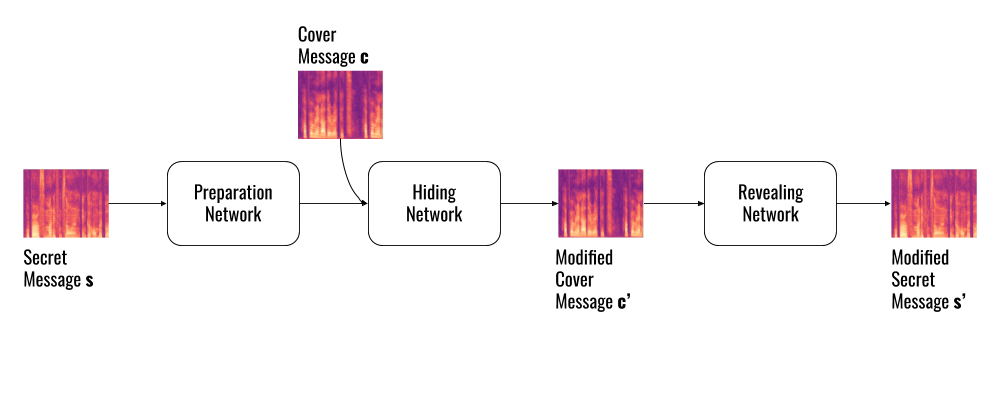

As part of the Cyber Crime & Forensics course at the [Security and Network Engineering Masters @ University of Amsterdam](https://www.os3.nl),  [Davide Pucci](https://www.davidepucci.it/) and I worked on building a neural network designed to embed a hidden audio message into a cover message in a way that is indistinguishable to the human ear.

<!--more-->

## Abstract
Digital steganography is the technique of hiding secret information into a file, known as the carrier. Traditional approaches lead to highly detectable steganography with alow ratio of information hidden to information carried over. Novel methods based on Artificial Intelligence have been emerging, revamping steganography and steganalysis leading to an increase in hiding capacity. In this paper, we show how deep learning can be a viable approach to achieve audio steganography. We build a Convolutional Neural Network inspired by the encoder-decoder model, that is capable of hiding a spectrogram representation of a secret audio file into a carrier spectrogram of the same length. We find that this method produces a lossy output but that the words from the secret and cover audio are audible.

[Link to the paper](/assets/research/stego.pdf)