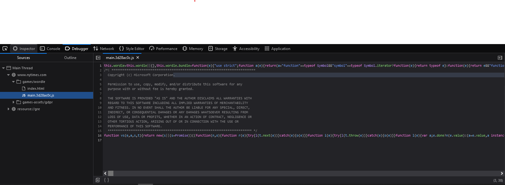
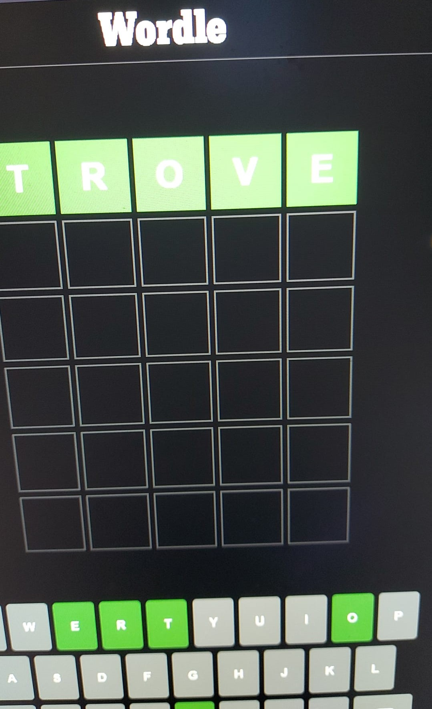

I've been playing Wordle for the past week. I got curious and decided to dig into the source code. My goal was to find out how guesses are validated - and it turns out to be designed in a strange way.

## Initial discovery

To kick off my search, I wanted to see if the [NYT wordle page](https://www.nytimes.com/games/wordle/index.html) was making any requests to a backend validation service. I imagined that a user would send a guess e.g. `hello` to a URL (let's say `https://www.nytimes.com/games/wordle?guess=hello`) and the backend would respond with an HTTP 200 OK containing True of False as a response body.

Before I could start digging for requests, I needed to turn the minified JavaScript into some readable code.



After running the code through a formatter, I had something I could work with:
```javascript
(this.wordle = this.wordle || {}),
    (this.wordle.bundle = (function (e) {
        "use strict";
        function a(e) {
            return (a =
                "function" == typeof Symbol && "symbol" == typeof Symbol.iterator
                    ? function (e) {
                          return typeof e;
                      }
                    : function (e) {
                          return e && "function" == typeof Symbol && e.constructor === Symbol && e !== Symbol.prototype ? "symbol" : typeof e;
                      })(e);
        }
        [...]
```

By chance I found a wordlist in the source code (!).

```javascript
var Ma = [
        "cigar",
        "rebut",
        "sissy",
        "humph",
        "awake",
        "blush",
        ...
]
```
My guess was that this was the list of accepted 5 letter words. Out of curiosity, I searched for the solution to the previous day's puzzle. Since I have been playing for a few consecutive days, I immediately noticed that this list was actually the list of solutions. To make things worse, the list was ordered, meaning that I today's word would be the next in the list:
```javascript
var Ma = [
    ...,
    "swill",
    "tacit",
    "other", // <= the solution to the day before yesterday's puzzle
    "thorn", // <= the solution to yesterday's puzzle
    "trove", // <= my guess is that this is the solution to today's puzzle?
    ...
]
```

I tried my luck, an lo and behold (excuse the bad quality pic, I was super excited about the find so I hurriedly snapped a pic from my phone instead of taking a screeshot)



## Reverse engineering

I wanted to dig a little deeper and check whether my intuition was right by looking at the source code. I wanted to find the code responsible for performing the validation, since I know the list of solutions is the list `Ma: List<string>` all I had to do was search for code using this list. I stumbled upon this interesting block:

```javascript
var Ba = new Date(2021, 5, 19, 0, 0, 0, 0);
function Ga(e, a) {
    var s = new Date(e),
        t = new Date(a).setHours(0, 0, 0, 0) - s.setHours(0, 0, 0, 0);
    return Math.round(t / 864e5);
}
function Va(e) {
    var a,
        s = Fa(e);
    return (a = s % Ma.length), Ma[a];
}
function Fa(e) {
    return Ga(Ba, e);
}
```

This section is returning the correct solution for a given day, let's see if we can rename the variables to make it cleaner:

```javascript
var wordleStartDate = new Date(2021, 5, 19, 0, 0, 0, 0);

function getDayOffset(startDate, date) {
    var s = new Date(startDate),
        t = new Date(date).setHours(0, 0, 0, 0) - s.setHours(0, 0, 0, 0);
    return Math.round(t / 864e5);
}
function getSolution(date) {
    var index, offset = getDayOffset(date);
    return (index = offset % wordList.length), wordList[index];
}
function getDayOffset(date) {
    return getDayOffset(wordleStartDate, date);
}
```

And voilà! Wordle started in 2021 on the 19th of May, so according to this logic, the solution for the puzzle on that day was `cigar`. On February 23rd, on the 249th day since Wordle was launched, the solution was indeed `trove`.

```javascript
var Ma = [
        "cigar", // solution day 0
        "rebut",
        "sissy",
        "humph",
        "awake",
        "blush",
        ...,
        "trove", // solution day 249
        ...
]
```

## How to make it cheat-resistant?

The guesses shouldn't be validated on the client side, but rather they should be sent to an API which returns True/False for each guess. Although this is the ideal solution it requires additional work since NYT would have to develop & maintain this API and make sure to apply rate-limiting to avoid having cheaters submit all 5 letter words in the english language every day.
