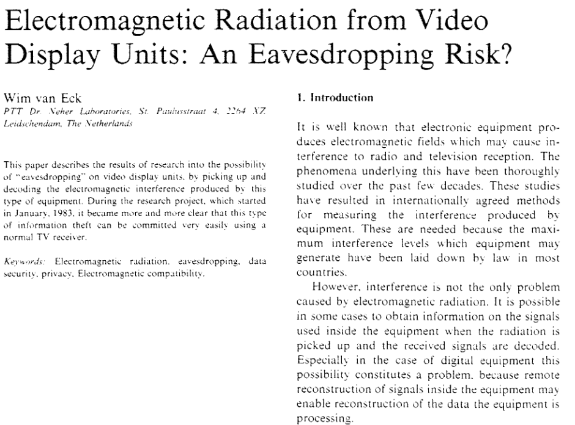
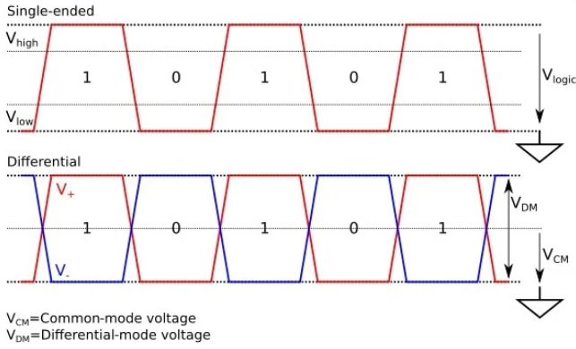
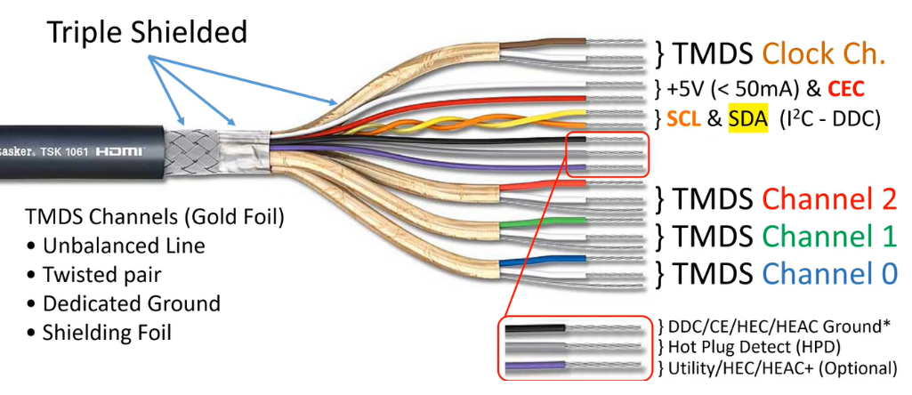
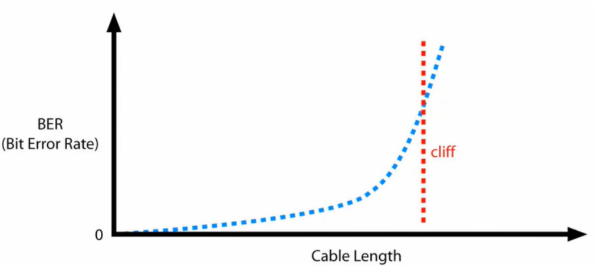
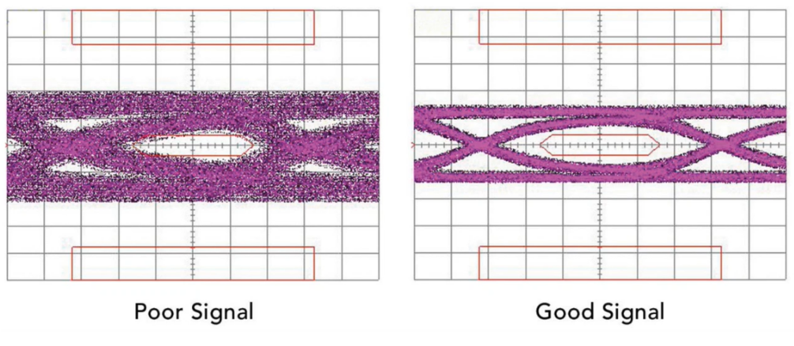
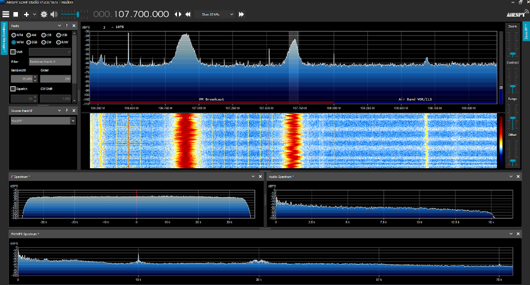
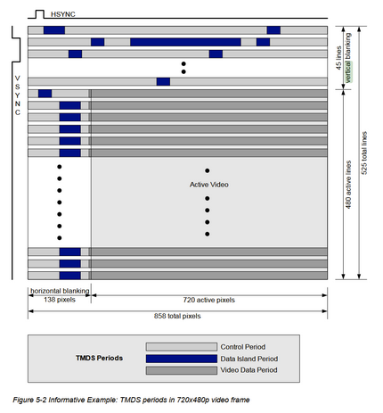
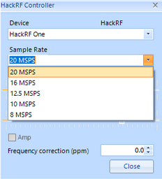
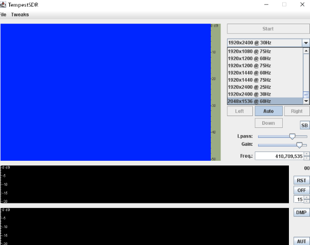

In this project I wanted to try learn how to spy on monitors using leaked electromagnetic signals.
<!--more-->

## Brief history
The name TEMPEST originates from a NSA & NATO certification. It refers to spying on information systems through leaking emanations, including radio or electrical signals, sounds, vibrations etc. It covers both spying and how to shield equipment against spying
[https://en.wikipedia.org/wiki/Tempest_(codename)](https://en.wikipedia.org/wiki/Tempest_(codename))



Disclaimer: apologies if any of the explanations are brief, the text is lifted from my slide deck.

## Equipment used for the project
I used a simple monopole antenna the HackRF One (the real thing - defintely not a cheap chinese clone...). See [https://www.antenna-theory.com/antennas/monopole.php](https://www.antenna-theory.com/antennas/monopole.php) for more info.


## Understanding High Definition Multimedia Interface (HDMI)

There are 3 main types of information that are transmitted through HDMI:
1. pixel color
2. encoded sound
3. timing information & AUX

### Transition Minimized Differential Signaling (TMDS)

The advantage of this signal type is that the two signals cancel there own noise. This means we can get a higher data throughput




### Cable Cross Section

Below you can see a cross section of an HDMI cable. Notice how it's triple shielded to reduce interference from other signals.
* TMDS channels 0, 1, 2 are for carrying red, green and blue channels that make up every pixel
* TMDS clock channel is for clock synchronisation
* all the rest is optional
    * the Consumer Electronis Control (CEC) detects when the cable is plugged into a device. It does so by always sending 5V down the cable. When it receives a return signal, it starts sending display identification data on the Serial Clock (SCL) and the Serial Data Lane (SDA)
* Purple cable is for HDMI ethernet



### Effects of Cable Length

It's important to notice that it's not a linear relationship. The cliff is at ~15m but about 5m for higher frame rates and resolutions.



### Eye Pattern

This is the TMDS seen from a cable under an oscilloscope


## HackRF Testing

I wanted to start off by making sure my cheap chinese HackRF clone wasn’t completely bogus, so I tuned in to a radio station at a known frequency

We can see the clear signal coming through in the SDR software. For information, I’m running SDRsharp because I was on windows at the time of the experiment. Gqrx is good for linux



### How do I know I'm picking up the right signal?
In practice, I’m just going to plug in the HDMI cable, plug in my HackRF, and start looking for a signal in my SDR software

We can estimate the expected frequency of a leaked HDMI signal by using this formula:
```
1 / tb = xt * yt * fv * nb

where nb is the number of bits per pixel
      fv is the refresh rate of the monitor e.g. 60Hz
      xt & yt are determined by the screen resolution such that for a screen 1920x1080 xt > 1920 and yt > 1080
```

Aside: you might have noticed that `xt` and `yt` are greater than instead of equals to the screen resolution. The reason for this is that video signals tend to have additional blanking intervals. This means more pixels are transmitted than what is in the active video region. This gives opportunity for the receiving monitor to synchronise its internal oscillator, calibrate its colour levels, or in case of CRT, allow enough time for the electron beam to return to the beginning of the next line on the screen. The synchronisation timings for personal computers have been standardised by Video Electronics Standards Association.

Given the formula above I can estimate that my ultra-wide screen would leak a signal at this frequency:
```
3440 * 1440 * 60 * 7 = 2 GHz
```


This is where I hit a road-block. The supported HackRF Mega Samples Per Second (MSPS) is limited to 20 MSPS which should be enough but the TempestSDR software doesn't support ultra-wide resolutions



### Alternatives

The formula above is only for HDMI, so what if we use VGA instead? For analog signals, the pixel density is modulated as an analogue voltage amplitude, so we lose the `nb` from the previous formula giving
```
1 / tb = xt * yt * fv

where fv is the refresh rate of the monitor e.g. 60Hz
      xt & yt are determined by the screen resolution such that for a screen 1920x1080 xt > 1920 and yt > 1080
```

Given my monitor this would bring the signal down to this frequency:
```
3440 * 1440 * 60  = 297 MHz
```

## Other crazy TEMPEST attacks
It's time to put of your tinfoil hats. TEMPEST applies to all leaked electromagnetic signals, not only HDMI. Here are some other attacks from published papers:

[Spy on speech by pointing an electro-optical sensor on a lightbulb up to 25m away (2020)](https://eprint.iacr.org/2020/708)

[Extract decryption keys via EM attacks on PC (2016)](https://link.springer.com/chapter/10.1007/978-3-319-29485-8_13)

[Keyboard acoustic emanations (2004)](https://ieeexplore.ieee.org/document/7243739)

[Smartphone keyboard (2019)](https://arxiv.org/abs/1903.11137)

[Covert channel between air-gapped (!) computers using thermal manipulations (2004)](https://ieeexplore.ieee.org/abstract/document/1301311/)
